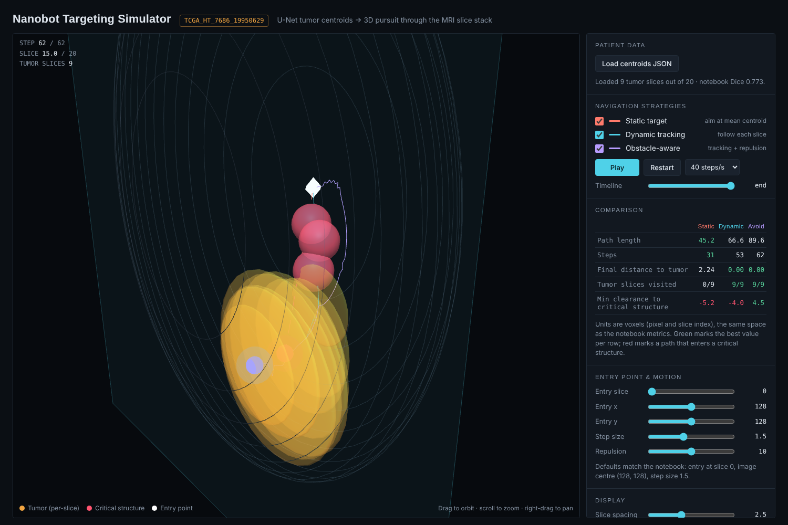

# Deep Learning-Guided Nanorobotic Targeting

U-Net brain-tumor segmentation (LGG MRI) -> slice-wise centroids -> 3D nanobot navigation, with two browser simulators and a Unity demo. **Simulation only, not clinical.**



## Repository layout
| Folder | What is inside |
|---|---|
| `simulators/` | Two single-file Three.js simulators (open in any browser) |
| `data/sim_data/` | Real exported centroid JSON for 20 validation patients (load into the simulators) |
| `notebook/` | Exported Kaggle notebook (U-Net training, metrics, centroid export) |
| `tools/run_nav.py` | Python version of the static/dynamic pursuit maths |
| `unity_demo/` | Unity toy demo scripts (synthetic cells) |
| `paper/` | Project report, IEEE-format paper, presentation |

## Quick start
Open `simulators/nanobot_targeting_simulator.html`, click **Load centroids JSON** and pick a file from `data/sim_data/`. The simulators load Three.js from a CDN, so they need an internet connection.

Key result (22 validation patients, 778 slices): Dice 0.773, IoU 0.746, tumor found in 20 of 22 patients.

---

# Nanobot Cancer Project — The Full Easy Explanation

This is the big, complete explanation of the whole project. Everything is explained in simple words — the idea, the code, the report, the slide deck, the simulators, and the bigger "how does this really work in real life" questions. Nothing technical is left unexplained.

---

# PART 1 — THE BIG IDEA

Imagine a tiny robot that could go inside the human body, find a brain tumor, and travel straight to it. We did not build a real robot. We built and tested the 3 things a real one would need:

1. **Seeing** — find the tumor in a brain scan picture.
2. **Deciding** — turn "here's the tumor" into "here's the path to reach it."
3. **Thinking** — a very basic onboard "brain" that can make small decisions.

Everything else in this project — the written report, the academic paper, the slide deck, the Unity game, and the two browser simulations — exists to show these 3 things actually working.

---

# PART 2 — HOW THE COMPUTER FINDS THE TUMOR (THE AI MODEL)

## 2.1 The idea in one line

We showed a computer thousands of real brain scan pictures, where a doctor had already marked exactly where the tumor is in each one. We did this over and over until the computer started noticing the pattern itself — "this kind of odd, bright area in the brain usually means tumor." That's it. No magic, just pattern-learning from lots of examples.

## 2.2 Where the pictures came from

Real, anonymous MRI brain scans of actual patients with brain tumors (gliomas), from a public medical research dataset (called "LGG," built from real hospital scans shared for research — from the Cancer Genome Atlas project). Every scan is actually many 2D picture-slices stacked together, like pages in a flipbook, and every slice has a matching black-and-white answer sheet showing exactly where the tumor is.

110 patients total. We used 88 of them to teach the computer, and kept 22 completely hidden, only used afterward to test how good it got.

## 2.3 The actual code — explained simply

This is the real code from the project, explained piece by piece in plain words:

```python
class UNet(nn.Module):
    def __init__(self, in_channels=3, out_channels=1):
        super().__init__()
        self.down1 = double_conv(in_channels, 64)
        self.down2 = double_conv(64, 128)
        self.down3 = double_conv(128, 256)
        self.down4 = double_conv(256, 512)
        self.pool = nn.MaxPool2d(2)
        self.bottleneck = double_conv(512, 1024)
        self.up4 = nn.ConvTranspose2d(1024, 512, 2, stride=2)
        self.upconv4 = double_conv(1024, 512)
        self.up3 = nn.ConvTranspose2d(512, 256, 2, stride=2)
        self.upconv3 = double_conv(512, 256)
        self.up2 = nn.ConvTranspose2d(256, 128, 2, stride=2)
        self.upconv2 = double_conv(256, 128)
        self.up1 = nn.ConvTranspose2d(128, 64, 2, stride=2)
        self.upconv1 = double_conv(128, 64)
        self.out = nn.Conv2d(64, out_channels, 1)

    def forward(self, x):
        d1 = self.down1(x)
        d2 = self.down2(self.pool(d1))
        d3 = self.down3(self.pool(d2))
        d4 = self.down4(self.pool(d3))
        bn = self.bottleneck(self.pool(d4))
        u4 = self.up4(bn); u4 = self.upconv4(torch.cat([u4, d4], dim=1))
        u3 = self.up3(u4); u3 = self.upconv3(torch.cat([u3, d3], dim=1))
        u2 = self.up2(u3); u2 = self.upconv2(torch.cat([u2, d2], dim=1))
        u1 = self.up1(u2); u1 = self.upconv1(torch.cat([u1, d1], dim=1))
        return torch.sigmoid(self.out(u1))
```

**What this is doing, in plain words:**
- Imagine looking at a photo. First you squint — you lose detail, but you notice the big picture ("something unusual is over there"). That's what `down1` to `down4` plus `pool` do: they shrink the picture smaller and smaller, step by step, while paying attention to bigger and bigger patterns instead of tiny pixels.
- `bottleneck` is the point where the picture is smallest and the "understanding" is most zoomed-out.
- `up1` to `up4` are the opposite — opening your eyes back up fully, going from the blurry big-picture idea back to a full, detailed picture.
- `torch.cat([u4, d4], ...)` — this is the clever part. While opening your eyes back up, we also hand back the original sharp details we remembered from before we squinted. This way, the final picture is both "roughly in the right place" (from the squinting/big-picture half) and "precisely traced" (from the sharp-detail half). This is literally why it's called "U-Net" — picture the shape of a U: down one side, across the bottom, back up the other side, with lines connecting matching points on both sides.
- `torch.sigmoid(...)` at the very end — turns every single pixel into a number between 0 and 1, meaning "how sure am I this pixel is tumor." Above 0.5 → call it tumor. Below 0.5 → call it normal tissue.

### How it actually learns (the training code)

```python
def dice_loss(pred, target, smooth=1e-6):
    pred = pred.view(-1)
    target = target.view(-1)
    intersection = (pred * target).sum()
    return 1 - (2.*intersection + smooth) / (pred.sum() + target.sum() + smooth)
```
**In plain words:** this is just a way of measuring "how wrong was the guess" by checking how much the guessed tumor shape overlaps the real tumor shape. Good overlap = low error. After every batch of pictures, the computer slightly tweaks its internal numbers to make this error a little smaller next time. Repeat this over the 88 training patients, 20 full rounds (called "epochs") — and by round 20, it's gotten decent at this task.

### How we measure how good it finally is (the scoring code)

```python
def dice_coefficient(pred, target, threshold=0.5, smooth=1e-6):
    pred = (pred > threshold).astype(np.float32)
    intersection = (pred * target).sum()
    return (2. * intersection + smooth) / (pred.sum() + target.sum() + smooth)

def iou_score(pred, target, threshold=0.5, smooth=1e-6):
    pred = (pred > threshold).astype(np.float32)
    intersection = (pred * target).sum()
    union = pred.sum() + target.sum() - intersection
    return (intersection + smooth) / (union + smooth)
```
**In plain words:** both of these just check "how much does the guessed tumor shape overlap the real tumor shape," expressed as one single score, with 1.0 meaning perfect match and 0 meaning no overlap at all. Run on all 22 test patients and averaged, this is exactly where our real numbers **Dice = 0.773** and **IoU = 0.746** come from.

### What actually happened when we trained it (the real numbers)

- Round 1: training error was 1.264, test error was 1.188 (both high — it knew nothing yet).
- Round 20 (the last one): training error dropped all the way to 0.174, but test error only dropped to about 0.58.
- Somewhere around round 9, the test error basically stopped improving, even though training error kept dropping. This is a normal thing in machine learning called **overfitting** — it means after round 9, the model mostly just got better at memorizing the exact training pictures, not at actually understanding brain tumors in general.
- Also: the code just saves whatever the model looks like after the very last round, not whichever round scored best. Round 19 actually scored very slightly better than round 20, but round 20 is what got saved. Small detail, but good to know.

### Final real results on the 22 hidden test patients:
- **Correctly found some tumor in 20 out of 22 patients** (completely missed it on 2).
- **77.3% average shape overlap (Dice)**, **74.6% on the other overlap measure (IoU)**.

### Real pictures from the notebook

These are actual images pulled directly from the training code — a real brain scan slice next to the doctor's real tumor marking and/or the computer's own guess, so you can see with your own eyes what it's learning from:


### A mistake we found and fixed in how we measured accuracy

At first, the code checked accuracy page-by-page (slice-by-slice) and then averaged those scores. The problem: most pages of a brain scan have zero tumor on them at all, and on those empty pages the math for "accuracy" doesn't really have a valid answer — it's like dividing 0 by 0. The old code handled this badly, which unfairly dragged the final average score down, making the model look worse than it actually was.

**The fix (real code):**
```python
TP = FP = FN = TN = 0
with torch.no_grad():
    for images, masks in val_loader:
        images = images.to(device)
        preds = (model(images).cpu().numpy() > 0.5).astype(np.uint8)
        masks_np = (masks.numpy() > 0.5).astype(np.uint8)
        for p, m in zip(preds, masks_np):
            p = p[0].flatten()
            m = m[0].flatten()
            TP += int(((p == 1) & (m == 1)).sum())
            FP += int(((p == 1) & (m == 0)).sum())
            FN += int(((p == 0) & (m == 1)).sum())
            TN += int(((p == 0) & (m == 0)).sum())

precision = TP / (TP + FP) if (TP + FP) else 0
recall    = TP / (TP + FN) if (TP + FN) else 0
```
**In plain words:** instead of scoring page-by-page, we add up every single correct-pixel and wrong-pixel count across the **entire** scan of all 22 patients first, and only calculate the final score once, at the very end, from those grand totals. That's the statistically correct way to do it.

**Real corrected result:** out of all the pixels checked (778 slices total): 351,552 correctly flagged as tumor, 49,579 wrongly flagged as tumor, 255,679 missed (real tumor that wasn't caught), and 50,330,198 correctly flagged as healthy. This gives:
- **Precision = 0.876** → when the model says "this is tumor," it's right 87.6% of the time (not many false alarms).
- **Recall = 0.579** → but it only actually catches 57.9% of all the real tumor pixels that exist (it plays it safe — misses some real tumor rather than falsely flagging healthy tissue).

---

# PART 3 — FROM "FOUND THE TUMOR" TO "A PATH TO TRAVEL"

Since a brain scan is many slices stacked together like pages, we find the middle point of the tumor blob on every single page. Connect all these middle points together, page after page, and you get a path through the body — like connecting dots — that traces exactly where the tumor is, from one end to the other. This uses simple geometry math (not AI) — literally just averaging pixel positions.

---

# PART 4 — HOW THE ROBOT DECIDES TO TRAVEL THAT PATH

Two ways were tested on real patient data:

- **Quick way (static):** average all the dots into one single target point and go straight there in a line. Fast (paths are about 46 steps long on average), but since the tumor isn't a single dot, this usually lands a little to the side of the real tumor — about 6 steps off on average, and in the worst real case (a patient with a tiny, scattered tumor) it missed by 27 steps.
- **Careful way (dynamic):** follow the dots one at a time, page by page, actually tracing the tumor's real shape. Slower (about 186 steps on average, roughly 4× longer), but it **always** ends exactly on real tumor tissue.

A third way only exists in the simulators (not tested on real patient data):
- **Obstacle-avoiding:** same as the careful way, but it also pushes itself away from things in its path instead of going straight through them.

**The trade-off in one line:** quick-but-sometimes-off vs. slower-but-always-correct.

---

# PART 5 — THE TINY "BRAIN" (HAND-BUILT NEURAL NETWORK)

Separate from the tumor-finding model, we also built a very basic, simple learning program completely by hand (every single calculation written manually, no ready-made AI tool doing the work). This is just to demonstrate that a nanobot could, in theory, carry its own small decision-making brain onboard. We tested 3 versions of different "thinking depth" (very simple, medium, and deeper) just to compare. This is a standalone demo — it's not connected to the tumor-finding part of the project.

---

# PART 6 — THE UNITY 3D GAME (AND THE BUG WE FIXED)

This is the original 3D scene where a nanobot visibly moves toward cancer cells and "destroys" them.

**The bug:** the nanobot's movement script was directly moving it to a position every frame, but Unity's physics system was still fighting it — gravity was pulling it down, and its solid collision shape was physically bouncing it away from the cancer cell before it could ever get close enough to count as "arrived."

**The fix (real code, added to `NanobotController.cs`):**
```csharp
void Awake()
{
    var rb = GetComponent<Rigidbody>();
    if (rb != null)
    {
        rb.useGravity = false;   // stop gravity pulling it off course
        rb.isKinematic = true;   // let the script fully control movement, not physics
    }
    foreach (var col in GetComponentsInChildren<Collider>())
        col.isTrigger = true;    // let it detect cells without bouncing off them
}
```
This runs once automatically when the nanobot is created, turning off gravity and making its collision "pass-through" so it can reach the cancer cells properly. This was already fixed and sent to you earlier.

---

# PART 7 — THE TWO BROWSER SIMULATORS (FULL DEMO + HOW TO USE + THE CODE)

Both are single files you can just double-click, or drag into any browser (Chrome, etc.). Nothing to install.

## 7.1 `nanobot_simulator.html` — compares the 3 path strategies on real patients

**How to use it, step by step:**
1. Open the file in a browser.
2. Click **"Choose file"** and pick a patient's data file (`sim_data_<patient>.json`) — twenty real patients' files are available.
3. Tick/untick the 3 checkboxes — **Static target, Dynamic tracking, Obstacle-aware** — to show or hide each path in the view.
4. Click **Play** to watch the nanobot move; **Restart** resets it; the speed dropdown changes how fast it plays.
5. Drag the **Timeline slider** to jump to any exact point manually, instead of watching it play through.
6. Below the viewer, a **table** shows the real numbers for that specific patient — path length and how close each strategy got to the tumor.
7. Extra sliders let you experiment: where the robot starts, how big each step is, how strong the obstacle-avoiding push is, and how far apart the slices are drawn (just visual).

## 7.2 `NanoBot_Tumor_Treatment_Sim.html` — the fuller, game-like swarm simulator

**A real screenshot of it running:**


**How to use it, step by step:**
1. Open the file — it starts right away with a made-up tumor shape, so you can try it immediately.
2. Click **"Load patient JSON"** (top bar) to instead shape the tumor using a real patient's actual data.
3. Use **Play/Pause**, **Restart**, and the speed dropdown (top bar) to control it.
4. The **left panel** shows live numbers: how many robots are deployed/active, how many cancer cells and healthy cells remain, how much drug has been delivered overall, and how much time has passed. The color key tells you red = cancer cell, purple = healthy cell, blue = robot, green = drug released.
5. The **right panel ("Inspector")** lets you look closely at one specific robot — its exact position, speed, how far it can "see," how much drug it has left, its battery, and what it's currently chasing. Click **"Follow"** to have the camera track it, or **"Next nanobot"** to look at a different one.
6. A line chart tracks how the number of cancer cells left changes over time, and a donut (circle) chart shows how much is destroyed vs. still being treated vs. still remaining vs. healthy cells accidentally harmed.
7. **2D / 3D / Reset camera buttons** let you change your view. You can also drag to rotate and scroll to zoom with your mouse.
8. **Settings** let you change: how many robots deploy, how big the tumor is (only for the made-up tumor), how far each robot can "see," whether robots go for the closest cell first or the tumor's center first, and whether robots should steer around healthy cells while moving.

### How the code actually decides what a robot chases (real code, explained simply)

```javascript
function pickTarget(b) {
  const from = (P.mode === "center" && !b.staged) ? null : b.pos;
  if (!from) return null;
  let best = null, bestD = Infinity, bestLocal = null, bestLocalD = Infinity;
  for (const c of cells) {
    if (c.dead || c.dying || c.claims >= 1) continue;
    const d = c.p.distanceTo(from) - c.r;
    if (d < bestD) { bestD = d; best = c; }
    if (d < P.detect && d < bestLocalD) { bestLocalD = d; bestLocal = c; }
  }
  return bestLocal || (P.mode === "nearest" ? best : best);
}
```
**In plain words:** the robot checks every cancer cell in its list (ignoring ones that are already destroyed or already being chased by another robot), and picks the closest one that's within its "seeing" range. If nothing is close enough, it just goes for whichever cancer cell is closest overall, no matter the distance.

```javascript
function steer(b, goal, dt, arriveDist) {
  // moves toward the goal, slowing down as it gets close
  // also nudges away from other nearby robots so they don't pile up
  // if "avoid healthy cells" is on, also nudges away from nearby healthy cells
  // if it still touches a healthy cell anyway, that cell gets marked as "affected"
}
```
**In plain words:** every tiny moment, the robot works out which direction to move to get closer to its target, while also gently pushing away from other robots nearby (so they don't all crowd into the same spot) and, if the setting is turned on, gently steering around healthy cells. If it still bumps into a healthy cell anyway, that counts as accidental damage — this is the "healthy cells affected" number you see on screen.

---

# PART 8 — DOES THE SIMULATION REALLY "DETECT" CANCER WHILE IT RUNS?

**No — and this is an important thing to understand.** While the simulation is playing, the computer is never actually working out "is this cell cancer or not" in real time. We already tell it the answer in advance, before the simulation even starts — like handing it an answer sheet ahead of time. The real "figuring out" already happened earlier — that's the AI model's job, explained in Part 2, which looked at the actual MRI scan and marked the tumor. The simulation just shows robots moving around cells that are already correctly labeled.

So:
- If you're using the **made-up tumor**: the "which cell is cancer" labels are just randomly assigned, purely for show, no real detection involved at all.
- If you **load a real patient's file**: the cancer-cell positions and shape genuinely come from the real AI model's actual output on that patient's scan — the simulator is just drawing that already-finished answer in 3D, not re-figuring it out live.

The "detection radius" setting in the simulator does **not** mean "how good is its eyesight at spotting cancer" — it just means "how close does a cell need to be before the robot bothers chasing it," purely to make the movement look more natural instead of all robots instantly snapping toward the single closest cell across the whole map.

---

# PART 9 — HOW WOULD A REAL NANOBOT (IN ACTUAL SCIENCE, NOT OUR PROJECT) FIND CANCER?

This part is just extra knowledge for context — our project does not actually do this. In real medicine, a tiny particle can't "see" anything the way a camera does, so scientists use completely different tricks:

- **Matching shape, like a key and lock:** cancer cells often have special markers on their surface that healthy cells don't have as much of. The particle is built to only stick to that exact marker — so it naturally avoids healthy cells, the same way a key only fits one specific lock.
- **Leaky blood vessels around tumors:** tumors tend to have messy, leaky blood vessels, so tiny particles of the right size naturally slip out and get trapped there more than in healthy, tightly-sealed blood vessels. This is more of a lucky accident of biology than active "detection."
- **Chemical environment:** tumors are often slightly more acidic than healthy tissue, or have higher levels of certain chemicals. Some particles are built to stay completely inactive until they sense that specific chemical environment, and only then release their medicine.
- **Using magnets:** doctors can first find a tumor's exact location using a regular scan (like an MRI), and then use an external magnet to physically pull specially-made magnetic particles toward that known spot — the tumor's location is found beforehand by a scan, not by the particle itself.

So in real life, there usually isn't a tiny camera-and-AI system riding inside a nanoparticle at all — the "smartness" is built into the chemistry of the particle itself, reacting automatically to its surroundings. Our project's real contribution is the scan-reading and path-planning part (Parts 2–4); the 3D simulations (Unity and the browser ones) are just visual demonstrations of what the *movement* could look like, not real working models of actual nanoparticle biology.

---

# PART 10 — THE BIGGEST PROBLEM WE FOUND — NUMBERS IN THE REPORT DIDN'T MATCH REALITY

**What happened:** the original written report and the original slide deck both said the model scored 82.8% match (Dice) and found tumor in all 22 of 22 test patients. But when your group member actually ran the real training code and sent me the real output, it printed 77.3% match and found tumor in only 20 of 22 patients — a real, genuine difference, not a typo or rounding error.

**Why this happens:** every time this kind of AI model is trained, it starts out by guessing completely randomly, then slowly improves bit by bit. It's like baking a cake where the oven starts at a random temperature every single time you turn it on — even using the exact same recipe (exact same code), you get a slightly different cake (a differently-trained model) every time you bake it (every time you run the training). That's exactly what happened here: the code always picks the same 88 vs. 22 patient split every time (that part is fixed and locked), but it never locks the random starting point for the model's learning, so every training run produces a genuinely different trained model.

**How we proved this wasn't just a mistake, not a guess:** one specific patient, `TCGA_FG_6688`, showed up in both the report's original sample data and the new real data your group member sent. The number of tumor slices found and the exact tumor positions for that same patient didn't match between the two — which could only happen if two different trained models produced them. That's solid proof, not speculation.

**What we did about it:** instead of leaving mismatched numbers sitting in the report, we rewrote the **entire** report to match the one real training result your group member actually has complete proof for (77.3% / 20-of-22) — every section, every table, every example patient, and the full list of 20 patients in the appendix. Every single number in the final report now matches that one real, traceable run.

**If you want to re-run the training and get the same result every time** (instead of a different result every time), add this near the top of the notebook, before the model is created:
```python
import torch, random, numpy as np
seed = 42
torch.manual_seed(seed)
torch.cuda.manual_seed_all(seed)
random.seed(seed)
np.random.seed(seed)
```
(This is like fixing the oven's starting temperature every time, so you get the same cake from the same recipe every time.)

---

# PART 11 — WHAT'S IN THE FINAL REPORT (SECTION BY SECTION, IN EASY WORDS)

The file `Nanobot_Targeting_Project_Report_FINAL.docx` is organized like this:

- **Summary at the top (Abstract):** the headline result in a few sentences — 77.3% match, tumor found in 20 of 22 patients, and the quick-way-vs-careful-way trade-off.
- **Dataset & training setup:** where the scan data came from, how we split 110 patients into 88 (teaching) and 22 (testing), and the training settings used. This part doesn't change no matter which training run you look at, since the patient split and settings are fixed.
- **Training section:** how the error number changed round by round, including the overfitting sign (test error flattening around round 9) and the note that the saved model isn't quite its single best round.
- **Example patients section:** walks through one specific patient in detail with a clean, simple result, and contrasts it with a messier, scattered-tumor example.
- **Path-finding results section:** the best-case and worst-case real examples for the quick-way vs. careful-way comparison.
- **Corrected accuracy section:** explains the precision/recall bug from Part 2 and gives the corrected real numbers.
- **Conclusion:** restates all the main results simply and explains what the corrected numbers mean in plain terms — the model plays it safe, missing some real tumor rather than wrongly flagging healthy tissue.
- **Tables:** all the final numbers laid out cleanly — overlap scores, path lengths, corrected accuracy, and known weak points/limitations.
- **Appendix (list at the end):** every single one of the 20 real patients with a detected tumor, with their individual path numbers — this is the full raw proof behind every summary number in the rest of the report.

---

# PART 12 — WHAT'S IN THE ACADEMIC PAPER

`Fixed_Nanorobotic_Paper.docx` is written in a more formal, academic style (meant to look like a research paper you'd submit somewhere), covering the same project but with more background, references to other similar research, and formal citations (the small numbers like [1], [2] that point to a list of sources at the end).

**What was wrong and what we fixed:** some citation numbers (like [13], [14], [16]) were used in the numbering but never actually appeared anywhere in the main text — basically a numbering mistake. We fixed this by renumbering every citation correctly in order, and we also filled in missing details (like full author names and journal names) for several reference entries that were incomplete.

---

# PART 13 — WHAT'S IN THE SLIDE DECK (AND WHY IT'S NOT FIXED YET)

`Deep_Learning-Guided_Nanorobotic_Targeting.pdf` is a 15-slide presentation deck, meant to be the short, visual version of the whole project for a talk or presentation. Here's what each slide roughly covers, in order:

1. **Title slide** — project name and author.
2. **The problem** — why a nanobot needs to know exactly where a tumor is before it can deliver treatment.
3. **Method overview** — the 5-step pipeline: MRI slices → AI model → middle points → 3D path → navigation.
4. **The data** — the 110-patient dataset, split into 88 for teaching and 22 for testing.
5. **The model** — the U-Net design explained simply (shrink down, build back up, with skip connections keeping edges sharp).
6. **Training** — how the error dropped over 20 rounds, and the overfitting note.
7. **Segmentation results** — the headline overlap score and detection rate.
8. **The metrics correction** — same precision/recall bug-and-fix explained in Part 2.
9. **From mask to target** — turning the tumor outline into path-following dots, with a worked example patient.
10. **Navigation strategies** — the quick-way vs. careful-way vs. obstacle-avoiding explanation.
11. **Navigation results** — the real path-length numbers.
12. **One patient's two paths** — a detailed side-by-side example.
13. **The interactive simulator** — introducing the browser simulator.
14. **Limitations and next steps** — honest weak points, like only testing on 2D slices instead of full 3D volumes.
15. **Conclusion** — wraps up the headline numbers and says thank you.

**The problem:** this slide deck still has the **old, mismatched numbers** from Part 10 above — it currently says 82.8% match and 22-of-22 patients detected, which we now know is from a different, unreproducible training run, not the real one your group member actually has full data for.

**Why we can't fix it ourselves:** we were only given the finished, locked PDF file — not the original editable slide file (PowerPoint, Google Slides, Keynote, Canva, whatever it was made in). A PDF can't be edited slide-by-slide the way a Word document can.

**What needs to happen:** either send the real editable slide file so the numbers can be updated directly to match the final report (77.3% / 74.6% / 20-of-22, and the corrected path numbers), or have whoever originally made the deck manually swap in the corrected numbers using Part 11 above as the reference.

---

# PART 14 — ALL THE FILES IN THIS PROJECT

| File | What it is |
|---|---|
| `Nanobot_Targeting_Project_Report_FINAL.docx` | Main written report — fully fixed and consistent |
| `Fixed_Nanorobotic_Paper.docx` | Academic paper — citation numbers fixed |
| `Deep_Learning-Guided_Nanorobotic_Targeting.pdf` | Slide deck — **still has old numbers, not yet fixed** |
| Unity scripts (`NeuralNetwork.cs`, `CancerCell.cs`, `TissueManager.cs`, `NanobotController.cs`, `SimulationManager.cs`) | The 3D nanobot game |
| `nanobot_simulator.html` | Browser simulator #1 — compares the 3 path strategies on real patient data |
| `NanoBot_Tumor_Treatment_Sim.html` | Browser simulator #2 — fuller, game-like swarm version |
| Training notebook | The actual code that teaches and tests the AI model |
| `sim_data_<patient>.json` files | Real exported data for 20 real patients, used by both simulators and the report's appendix |
| `demo_images/` | Real pictures — 8 scan examples from the notebook + 1 simulator screenshot |

---

# PART 15 — WHAT'S STILL LEFT TO DO

Only one thing: the **slide deck** still has the old, mismatched numbers (explained fully in Part 13). It needs either the real editable source file sent over, or a manual update by whoever originally built it, using the corrected numbers from Part 11.

Everything else — the written report, the academic paper, the Unity game fix, both simulators, and the accuracy-measurement correction — is done and consistent.
